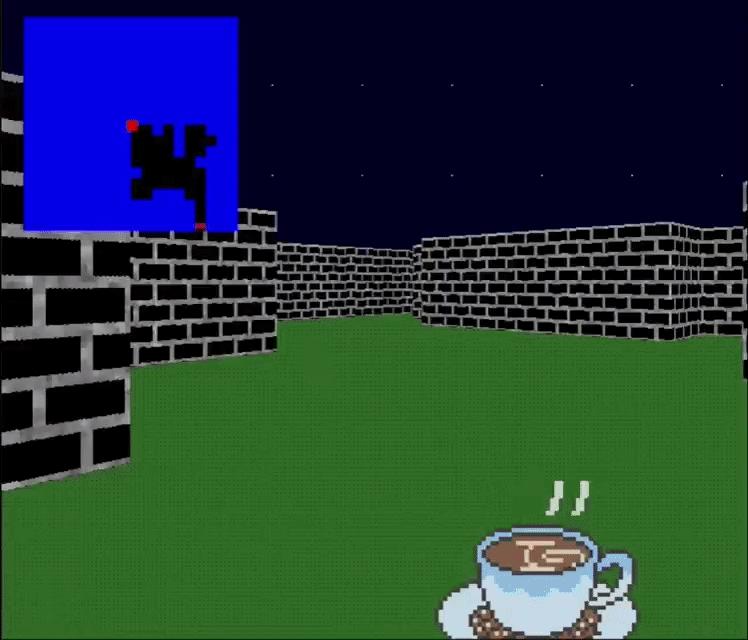

# cub3D


Software raycasting engine in C on top of MiniLibX/X11: no GPU and no 3D API. Every frame is computed column
by column into an off-screen image and blitted once. Parses `.cub` scene files, renders textured walls with
perspective correction, and in the bonus build adds doors, minimap, mouse look and an animated view model.

Team project with [angelurano](https://github.com/angelurano). Graded **125/100** (mandatory + all bonus).



## Build & run

```sh
git clone --recursive https://github.com/DanielCasti11o/cub3D && cd cub3D
# already cloned without --recursive:  git submodule update --init --recursive

make            # mandatory build
make bonus      # same sources compiled with -DBONUS=1
./cub3D assets/maps/subject1.cub
./cub3D assets/maps/bonus/simple.cub        # bonus maps use doors ('D')
```

Requires `cc`, `make` and X11 dev headers (`libx11-dev libxext-dev`) for MiniLibX.

| Target | Flags |
|---|---|
| `make` / `make bonus` | `-Wall -Wextra -Werror -O2` |
| `make debug` / `debug_bonus` | `-g3 -Og -fno-omit-frame-pointer` |
| `make dev` / `dev_bonus` | `-fsanitize=address,undefined,leak` |

**Controls:** `W A S D` move/strafe · `← →` rotate · `↑ ↓` look up/down · mouse look (bonus) · `Esc` quit.

## Scene file (`.cub`)

```
NO ./assets/textures/colom.xpm     # wall textures per face
SO ./assets/textures/cool.xpm
WE ./assets/textures/daniel.xpm
EA ./assets/textures/angel.xpm
DO ./assets/textures/sample/door.xpm   # bonus, required if the map has 'D'
F 105,105,105                      # floor RGB
C 173,216,230                      # ceiling RGB

1111111111
1000N00001                         # 1 wall · 0 floor · N/S/E/W spawn + facing
10000D0001                         # D door (bonus) · ' ' void
1111111111
```

## Implementation

### Parsing

- **Single pass, state machine** (`SP_HEADER → SP_MAP → SP_DONE`) over `get_next_line`.
- **Header bitmask**: every identifier sets a bit (`E_NO = 1<<0 … E_DO = 1<<8`). Duplicates are caught with `seen & bit`
  and missing elements by comparing `seen` against the mandatory mask, so each error is reported with a specific message.
- Map lines are buffered in a linked list with a tail pointer (O(1) append), then materialized as a rectangular grid cropped to the map's horizontal bounding box.
- **Closed-map validation**: any walkable cell (`0`, `D`, spawn) adjacent to void (space, padding, or outside the grid) means the map is open → error.
  Also enforces exactly one spawn, no empty lines inside the map, RGB components in `[0,255]` and loadable XPM textures.
- **Door orientation** is inferred from neighbors during parsing: `D` becomes `H` or `V` depending on which sides have walls.

### Rendering pipeline (per frame)

```
update_player() → clear_image() → raycasting() → [view model, minimap] → mlx_put_image_to_window()
```

For each screen column `x ∈ [0, WIDTH)`:

1. **Ray setup**: `camera_x = 2x/WIDTH − 1`, `ray = dir + plane · camera_x`, with `|plane| = tan(FOV/2)` and FOV = 66°.
2. **DDA**: `delta = |1/ray|` per axis; step through grid lines choosing the nearer of `side_dist.x / side_dist.y`
   until a `1` is hit. Exact cell traversal, no fixed-step marching.
3. **Perpendicular distance**: computed from the hit cell and step direction, not Euclidean distance, which removes fisheye distortion.
4. **Projection**: `line_height = HEIGHT / dist`, centered on `HEIGHT/2 + pitch` (y-shearing for vertical look).
5. **Texturing**: face chosen from hit side + ray sign (N/S/E/W); `wall_x` is the fractional hit coordinate → `tex_x`,
   mirrored on two faces so textures aren't flipped; `tex_y` advances by `tex_height / line_height` per pixel.
6. Ceiling and floor are filled with the parsed RGB colors around the wall stripe.

### Framebuffer

- One `mlx` image used as a back buffer. Pixels are written directly into `mlx_get_data_addr()` memory
  (`addr + y·size_line + x·bpp/8`) with bounds checks, then presented with a single `mlx_put_image_to_window`. No per-pixel X11 calls, no flicker.
- Colors packed as 32-bit BGRA (`t_color` matches little-endian layout).

### Bonus (`-DBONUS=1`)

| Feature | How |
|---|---|
| **Doors** | Thin panels (`DOOR_THICK = 0.1`) inside a cell. During DDA the ray computes its intersection with the panel plane and with the panel's side faces, keeping its own distance/height so the door is drawn over the wall behind it. |
| **Collisions** | Axis-separated: X and Y movement are tested independently against walls with a 0.2-cell margin, so the player slides along walls instead of stopping. |
| **Mouse look** | Pointer delta from window center → yaw (angle) and pitch; pointer re-centered each event with `mlx_mouse_move`. |
| **Minimap** | Top-down grid render of walls, doors and player position. |
| **View model** | 5-frame animated XPM sequence (`coffee_1…5.xpm`) advanced every `VM_DELAY` loops and composited with transparency over the 3D view. |

## Layout

```
inc/           cub3d.h (constants, prototypes) · structs.h (all data types, documented)
src/core/      init (mlx, textures, player) · loop (input → render → present)
src/parse/     headers, map, validation, error reporting
src/rendering/ ray (DDA) · wall (projection, texturing) · door/door_dist · minimap · animated · doublebuff
src/events/    key/mouse hooks, movement and collision
src/utils/     math, color, free
libs/          libft · minilibx-linux (git submodule)
assets/        maps (valid + invalid test cases) · XPM textures
```
