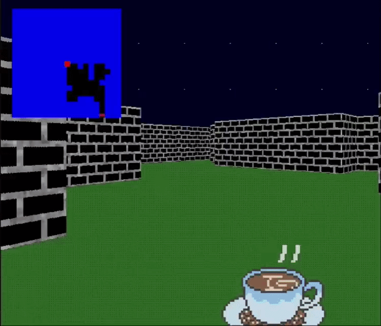

# 🏰 cub3D - RayCasting Game Engine


## 🗣️ About

**cub3D** is a project inspired by the world-famous 90s game *Wolfenstein 3D*, considered the first FPS ever created. The goal was to build a dynamic 3D graphic engine using the **RayCasting** technique from scratch, written entirely in **C** using the MinilibX library.


## 🎮 Gameplay Preview




## ✨ Features

We achieved a **125% score** by implementing the mandatory part plus all bonus features.

### 🏁 Mandatory Part
- **RayCasting Algorithm**: Rendering a 3D projection from a 2D map.
- **Texture Mapping**: Different textures for North, South, East, and West walls.
- **Color Management**: Floor and Ceiling colors parsed from RGB values.
- **Movement**: Basic player movement and camera rotation.

### 🌟 Bonus Part
- **🚪 Doors**: Functional doors that can open and close.
- **🐭 Mouse Control**: Camera rotation using the mouse for a smoother experience.
- **🗺️ Minimap**: Real-time minimap display showing player position and rays.
- **👾 Animated Sprites**: Rendering of objects/enemies with animation frames.
- **💥 Wall Collisions**: Accurate collision detection to prevent walking through walls.


## ⚙️ Technical Highlights

The engine is built with performance and precision in mind:

- **DDA Algorithm (Digital Differential Analyzer)**: Used to calculate the intersection of rays with the grid lines of the map for precise wall rendering.
- **Double Buffering**: Implemented to render frames off-screen before displaying them, eliminating screen flickering.
- **Bitwise Parsing**: Highly efficient map parsing logic using bitwise operations and custom structures.
- **Endianness Handling**: Manual handling of pixel byte order to ensure correct RGBA color display across different architectures.
- **MinilibX & X11**: Used for window management and event handling.


## 🛠️ Installation & Usage

### Requirements
- GCC Compiler
- Make
- X11 include libraries (for Linux)

### Compiling
Clone the repository and compile the project:

# Clone the repository AND initialize submodules (MinilibX)
```bash
git clone --recursive https://github.com/DanielCasti11o/cub3D
cd cub3D
```

# If you cloned without --recursive:
```bash
cd cub3D
git submodule update --init --recursive 
```

# Compile

### Normal compilation
```bash
make
```

### Cleanup
```bash
make clean
#or
make fclean
```

### Bonus compilation
```bash
make bonus
```

# RUN 
```
./Cub3D ./assets/maps/a_map.cub # or any map in ./assets/maps/ or ./assets/maps/bonus/
```
